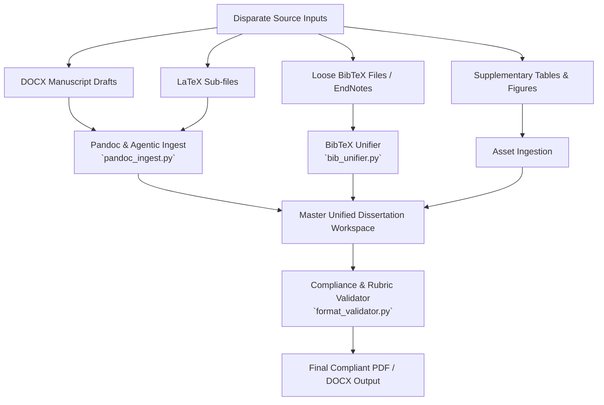

# Dissertation Formatting Tutorial & Agentic AI Unification Framework

> **Author**: Sebastián Cruz-González  
> **Target Institution**: University of California, San Francisco (UCSF) Graduate Division & ProQuest ETD  
> **Super-Directory**: `/Users/sgonzalez/Desktop/Capra Lab/Dissertation_Template_and_Agentic_Pipeline/`

---

## 1. Executive Summary & Overview

Completing a Ph.D. dissertation requires transforming years of heterogeneous research outputs—ranging from co-authored Microsoft Word manuscript drafts (`.docx`), raw LaTeX documents (`.tex`), standalone reference libraries (`.bib`), Jupyter Notebooks, supplementary tables, and high-resolution figures—into a single, highly structured, institutionally compliant document.

This guide provides:
1. **Standardized Dual-Track Templates**: Production-ready LaTeX and Microsoft Word configurations adhering strictly to UCSF Graduate Division and ProQuest publication rubrics.
2. **An Agentic AI Unification Pipeline**: Conceptual frameworks, system prompts, and python automation tools (`agentic_scripts/`) to orchestrate LLM agents in ingesting, unifying, deduplicating, and formatting disparate source materials.

---

## 2. Institutional & ProQuest Formatting Rubric

Below is the definitive formatting rubric synthesized from UCSF Graduate Division and ProQuest guidelines:

### A. Typography & Spacing
- **Font Selection**: Times New Roman (12pt), Georgia (11–12pt), or Arial (10–12pt). Main text must be pure black (`#000000`).
- **Line Spacing**:
  - **Body Text**: Double-spaced throughout preliminary pages and main chapters.
  - **Single-Spaced Exceptions**: Long indented quotations, footnotes, figure captions, table text, and preliminary titles.
- **Margins**: Exactly **1.0 inch** on top, bottom, left, and right sides. No elements may bleed into margins.

### B. Pagination & Front Matter Architecture
- **Title Page**: Always Page `i` (counted, but **NO page number printed**).
- **Preliminary Pages**: Copyright, Abstract, Dedication, Acknowledgments, Table of Contents (TOC), List of Figures (LOF), and List of Tables (LOT).
  - Numbered sequentially with lowercase Roman numerals (`ii, iii, iv...`).
  - Printed centered or right-aligned at least **0.5 inches** from the bottom edge.
- **Main Body Chapters**: Chapters 1 through Conclusion, References, and Appendices.
  - Numbered sequentially with Arabic numerals (`1, 2, 3...`), restarting at Page 1 on Chapter 1.

---

## 3. Disparate Format Unification: The Agentic AI Pipeline

When pulling together published manuscripts, draft DOCX files, and raw data, traditional copy-pasting introduces formatting degradation, broken references, and inconsistent styles. Agentic AI agents solve this by operating as automated format compilers and content reconcilers.



---

## 4. Reusable Agentic AI System Prompts

You can use the following system prompts with LLM agents (such as Antigravity agents) when converting and editing dissertation chapters:

### Prompt Pattern A: Manuscript Ingestion & LaTeX Standardization
```text
You are an expert academic typesetter and LaTeX specialist.
Convert the attached manuscript section (from DOCX or Markdown) into clean LaTeX following these rules:
1. Maintain all section hierarchy (\chapter, \section, \subsection).
2. Wrap all figures in \begin{figure}[htbp] ... \end{figure} using \singlespacing for captions.
3. Replace all inline citations with \cite{citation_key}.
4. Convert raw markdown or word tables into \begin{table} with \usepackage{booktabs} formatting (\toprule, \midrule, \bottomrule).
5. Ensure no raw formatting or hardcoded linebreaks leak into the LaTeX output.
```

### Prompt Pattern B: Citation Reconciliation & BibTeX Cleaning
```text
You are an automated bibliography database editor.
Given the attached raw reference list and BibTeX entries:
1. Deduplicate entries sharing the same DOI or Title.
2. Standardize all entry keys to 'AuthorYear' (e.g., Smith2024).
3. Strip non-essential fields: 'issn', 'isbn', 'urldate', 'eprint', 'language'.
4. Ensure every entry contains a valid DOI and journal title.
5. Return ONLY the cleaned BibTeX block.
```

---

## 5. Automation Toolkit Reference (`agentic_scripts/`)

The repository includes three Python tools to automate conversion and compliance checking:

### 1. `bib_unifier.py`
Merges and cleans multiple `.bib` files across chapters.
```bash
python3 agentic_scripts/bib_unifier.py ch1_refs.bib ch2_refs.bib -o templates/latex/references.bib
```

### 2. `pandoc_ingest.py`
Converts `.docx` or `.md` files into clean, typeset LaTeX chapter snippets.
```bash
python3 agentic_scripts/pandoc_ingest.py draft_manuscript.docx -o templates/latex/ch3_template.tex -f latex --title "Epigenetic Clock Validation"
```

### 3. `format_validator.py`
Performs automated static compliance analysis against the official UCSF / ProQuest ETD rubric for **both** LaTeX (`.tex`) and Word (`.docx`) files.
```bash
# Validate LaTeX dissertation master
python3 agentic_scripts/format_validator.py --tex templates/latex/dissertation_master_template.tex

# Validate Word dissertation draft against institutional rubric
python3 agentic_scripts/format_validator.py --docx "my_dissertation_draft.docx" --rubric rubric/rubric_full.txt
```

---

## 6. Directory Map of the Template Package

```
Capra Lab/Dissertation_Template_and_Agentic_Pipeline/
├── dissertation_agentic_workflow_guide.md   # Master tutorial & workflow manual
├── templates/
│   ├── latex/
│   │   ├── dissertation_master_template.tex # Master UCSF compliant LaTeX file
│   │   ├── titlepage_template.tex          # Official UCSF title page layout
│   │   ├── ch1_template.tex                # Sample Chapter 1
│   │   ├── ch2_template.tex                # Sample Chapter 2
│   │   └── references.bib                  # Unified BibTeX database
│   └── word/
│       └── dissertation_word_guide.md      # Complete MS Word style & field guide
└── agentic_scripts/
    ├── bib_unifier.py                      # BibTeX deduplicator & cleaner
    ├── pandoc_ingest.py                    # Multi-format manuscript ingestion wrapper
    └── format_validator.py                 # Institutional rubric validator
```
